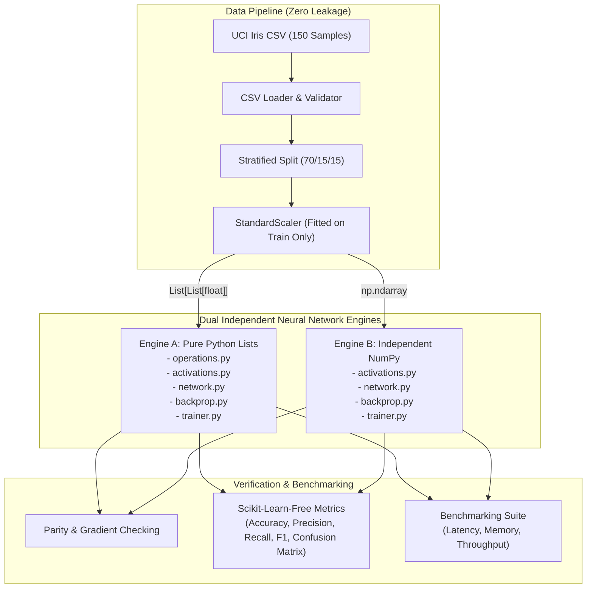

# ListAI — System Architecture & Engine Isolation

**Repository:** [https://github.com/devsamikhan/ListAi](https://github.com/devsamikhan/ListAi)

---

## 1. Architectural Philosophy

ListAI is built with a dual-engine architecture designed for educational transparency, strict modularity, and mathematical parity.



---

## 2. Directory Structure and Responsibilities

```text
ListAI/
├── data/                      # Canonical dataset storage
│   ├── iris.csv               # 150-sample UCI Iris dataset
│   └── README.md
├── docs/                      # Technical documentation & derivations
│   ├── ARCHITECTURE.md
│   ├── BENCHMARK_METHODOLOGY.md
│   ├── LISTS_IN_AI.md
│   ├── LISTS_VS_NUMPY.md
│   ├── MATHEMATICS.md
│   └── PROJECT_OVERVIEW.md
├── listai/                    # Core library package
│   ├── config.py              # Centralized dataclass configurations
│   ├── data/                  # Loading, splitting, standardization
│   │   ├── loader.py
│   │   ├── preprocessing.py
│   │   └── splitting.py
│   ├── engines/               # Dual isolated neural network engines
│   │   ├── list_engine/       # PURE Python Lists (Zero external dependencies)
│   │   │   ├── activations.py
│   │   │   ├── backprop.py
│   │   │   ├── loss.py
│   │   │   ├── network.py
│   │   │   ├── operations.py
│   │   │   └── trainer.py
│   │   └── numpy_engine/      # Independent NumPy Engine
│   │       ├── activations.py
│   │       ├── backprop.py
│   │       ├── loss.py
│   │       ├── network.py
│   │       └── trainer.py
│   ├── evaluation/            # Custom metrics and formatted reports
│   │   ├── metrics.py
│   │   └── reports.py
│   └── utils/                 # Reproducibility and timing utilities
│       ├── reproducibility.py
│       └── timing.py
├── results/                   # Live benchmark results
│   └── benchmark_report.md
├── scripts/                   # Standalone workflow scripts
│   ├── prepare_iris.py
│   └── run_benchmarks.py
├── tests/                     # 43+ Comprehensive unit test suites
│   ├── test_activations.py
│   ├── test_backprop.py
│   ├── test_data_pipeline.py
│   ├── test_engine_parity.py
│   ├── test_forward_pass.py
│   ├── test_foundation.py
│   ├── test_gradient_check.py
│   ├── test_list_operations.py
│   ├── test_loss.py
│   ├── test_metrics.py
│   └── test_trainer.py
├── main.py                    # Unified CLI entrypoint
├── pyproject.toml
└── requirements.txt
```

---

## 3. Strict Engine Isolation Guard

To preserve academic and architectural integrity, Engine A must never import or rely on any external numerical computing framework. This rule is enforced automatically in the continuous testing suite via AST (Abstract Syntax Tree) static analysis:

```python
FORBIDDEN_LIBRARIES = ("numpy", "pandas", "scipy", "tensorflow", "torch", "keras", "jax", "sklearn")
```

Every file under `listai/engines/list_engine/` is parsed into an AST. Any `ast.Import` or `ast.ImportFrom` matching any forbidden library causes an immediate unit test failure.

---

## 4. Parameter Synchronization Interface

Both `ListNeuralNetwork` and `NumpyNeuralNetwork` implement identical parameter serialization protocols:
- `get_params() -> Dict[str, List]`: exports weights and biases as serializable nested Python lists.
- `set_params(params: Dict[str, Sequence]) -> None`: imports weights and biases into the respective engine.

This protocol allows cross-engine parity testing to inject identical starting states into both networks and verify that forward activations, loss outputs, and analytical gradients match within floating-point tolerance ($10^{-12}$).
